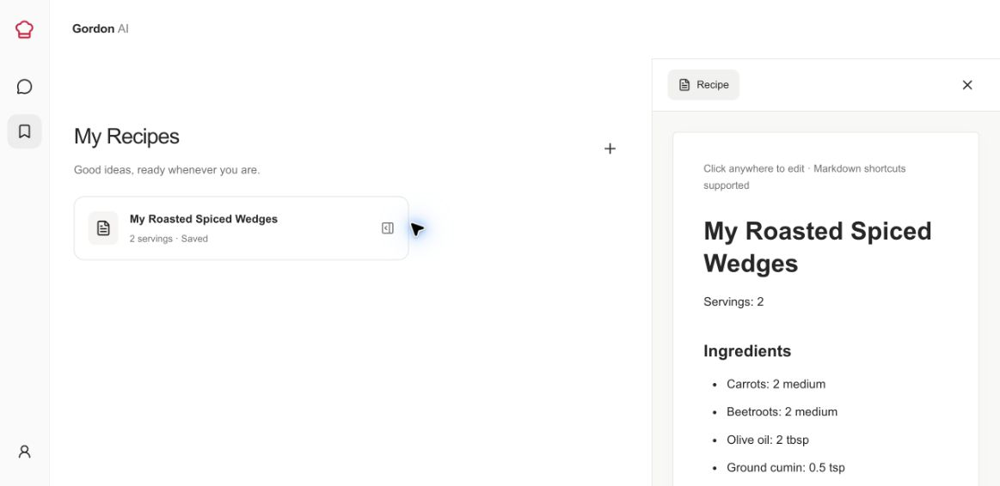
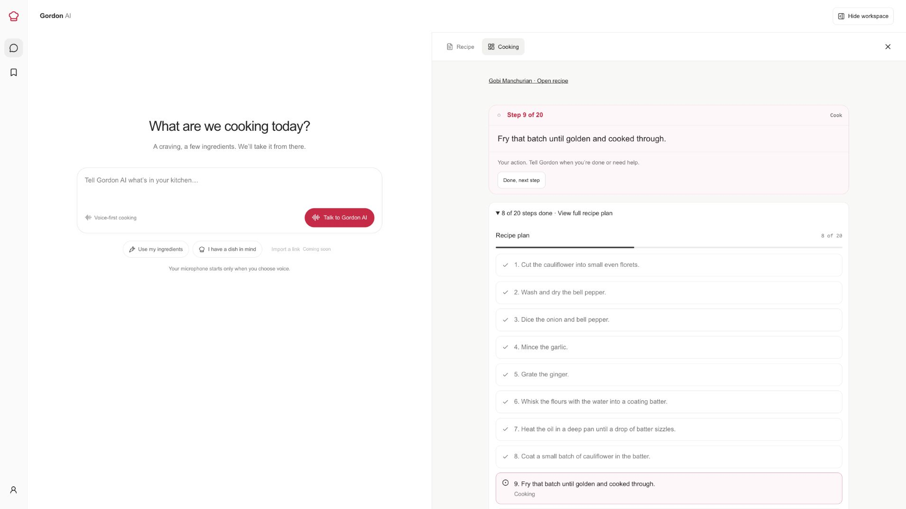

# Gordan AI Live

**Your hands cook. Gordan keeps up.**

Turn ingredients or a craving into dinner with a voice sous-chef that helps you choose, prep, cook and plate. Ask a question mid-chop or check a timer without losing your place.

**[Try the live app](https://gordan.kushalmurthy.com)** · [Local setup](DEVELOPMENT.md) · [Product design](DESIGN.md) · [Deployment](DEPLOYMENT.md)

*An actual local workspace capture: saved recipes and direct document editing.*

## Inspiration

Your hands are busy, the recipe is on a screen, and several things need attention at once. We wanted a companion you could talk to throughout the meal, from “What can I make?” to “How should I plate this?”

## What it does

| Moment | Gordan helps you |
|---|---|
| “I have carrots and beetroot.” | Explore dish choices before creating a recipe. |
| Choose by voice or click | Adapt ingredients and build an editable recipe. |
| Start preparation | Follow the dish’s actual actions, however many it needs. |
| Start cooking | Get technique, heat and sensory cues alongside real timers. |
| Interrupt or reconnect | Continue with saved conversation and progress. |

Decisions stay in chat. The recipe is an editable Markdown document backed by JSON. Voice and optional buttons update the same progress. An elapsed clock starts with cooking; named countdowns track individual tasks.

See the cooking plan and current action

*Local example showing dish-specific progress, rather than three fixed steps.*

## How we built it

**Next.js, TypeScript and Assistant UI** power the interface. **LiveKit Agents and Gemini Live** handle realtime voice. **Firebase Google authentication and Firestore** store each cook’s work. The web/API runs on **Cloud Run**; the agent runs on **LiveKit Cloud**.

The key choice: flexible conversation backed by durable execution state. Two application tools edit recipes and update cooking through a shared validated API. Saved action IDs and timer timestamps survive independently of model context; committed changes stream to the interface and agent. Bundled cooking guidance supports natural coaching within one session.

## Challenges we ran into

- **Premature recipes:** revised discovery guidance to explore preferences and offer choices without a mandatory questionnaire.
- **Voice/UI drift:** shared saved state synchronizes spoken and manual progress.
- **Timer continuity:** persist deadlines and start the cooking clock once. Expiry means check the food, not mark it cooked.

## Accomplishments that we're proud of

One conversation connects dish discovery, editable recipes and dish-specific coaching through plating. A deployed synthetic-audio rehearsal exercised saved progress, countdown alerts and reconnect through the actual voice pipeline.

## What we learned

Useful coaching explains technique and sensory endpoints, then gives the cook time. Reliable assistance also needs durable application state: conversational memory alone cannot own progress or timers.

## What's next

Recipe-link import, grounded recipe research, closed-browser notifications and richer coordination of overlapping tasks. Immediate validation priorities are a complete human cooking rehearsal and two-account isolation testing.

## Run locally

Requires Node 24, pnpm 10.28.1 and LiveKit/Gemini credentials. [Follow the ordered setup guide](DEVELOPMENT.md): clone → configure environment → install → start web and agent. It includes Firebase sign-in and a local development alternative.

## Verification and limits

Recorded release checks passed: 50 unit tests, type checks, lint and production build. Google login was manually confirmed; production synthetic audio covered timers and reconnect. Earlier text simulations passed 4/5. [Evidence, commands and remaining gaps](DEVELOPMENT.md#verification-and-limits).

One active meal per account. No camera or live recipe research. Audible alerts require an active browser or connected agent. Full human cooking and two-account isolation verification remain outstanding.

## Credits

Based on the official LiveKit [React](https://github.com/livekit-examples/agent-starter-react) and [Node](https://github.com/livekit-examples/agent-starter-node) starters; upstream MIT licenses are retained. See the [cooking skill](apps/agent/skills/cook-with-gordon/SKILL.md).
